<!-- Panels are generated by scripts/build.py from the GitHub API and the Biskin Studio brand fonts.
     .github/workflows/profile.yml rebuilds them every day. Edit the script, not the SVGs. -->

  

  

  

  
  

  
  

  
  

  

  

  

  
  
  

  

  

